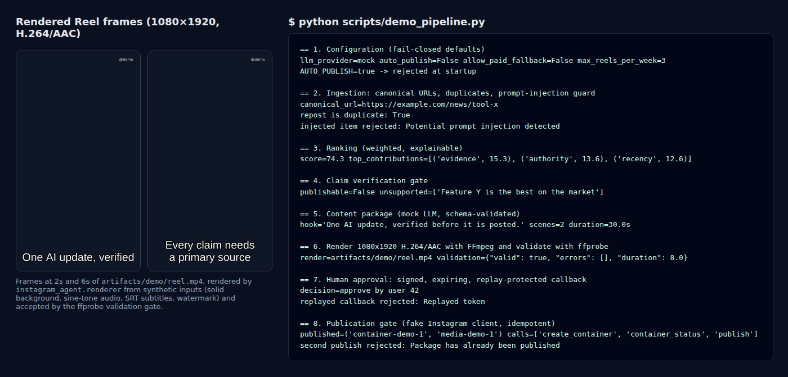
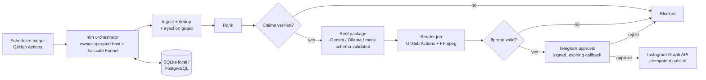

# Instagram AI Content Agent

**A fail-closed, human-approved pipeline for turning verified AI news into Instagram Reels: nothing is published without source-backed claims, a validated render, and a signed human approval.**

[](https://github.com/Akshatb848/instagram-ai-content-agent/actions/workflows/test.yml)
[](https://github.com/Akshatb848/instagram-ai-content-agent/actions/workflows/security.yml)
[](LICENSE)




<sub>Output of `python scripts/demo_pipeline.py`, run locally: every stage below executes the real code in `src/instagram_agent/` on **synthetic** inputs, with no network and no credentials. The frames come from the MP4 the renderer produced, which then passed the ffprobe validation gate.</sub>

---

## What it does

The agent is designed to find trustworthy AI updates, reject duplicates and unsupported claims, build a structured Reel package, render a vertical video deterministically with FFmpeg, and publish **only** through the official Instagram API after a person approves it in Telegram.

The core library implements and tests these safety gates:

| Gate | Module | What it enforces |
|------|--------|------------------|
| Fail-closed config | `config.py` | `AUTO_PUBLISH=true` or `ALLOW_PAID_FALLBACK=true` are rejected at startup; hard caps (≤3 Reels/week, ≤30 source items/run, ≤60 s video, 1 concurrent render) |
| Safe ingestion | `ingestion.py` | URL canonicalisation (tracking params stripped), duplicate detection (URL, content hash, title hash, token/sequence similarity), prompt-injection rejection, host allowlist + public-IP (anti-SSRF) check |
| Explainable ranking | `ranking.py` | Weighted score with per-factor contributions; misinformation and copyright risk subtract |
| Claim verification | `verification.py` | Claims without a primary source, with conflicting sources or below the confidence threshold block publication |
| Content contract | `llm.py`, `schemas.py` | Gemini / Ollama / mock providers; output must validate against the `ReelPackage` Pydantic schema (no unsupported claims, scenes within duration) |
| Renderer | `renderer.py` | FFmpeg argument-array command (no shell), 1080×1920 H.264/AAC, SRT subtitles, watermark, loudness normalisation, ffprobe validation, SHA-256 manifest |
| Human approval | `security.py`, `approval.py` | HMAC-signed, expiring, nonce-based (replay-protected) callbacks from allow-listed Telegram users |
| Publication | `publishing.py` | Requires approval + valid render + zero unsupported claims; idempotent per package |
| Quotas | `quotas.py` | Free-tier limits enforced in code before any provider call or render dispatch |

## Architecture



- **Orchestration:** 10 n8n workflow exports in `n8n/workflows/` (WF-01 source collection … WF-10 failure handler), validated secret-free by `scripts/validate-workflows.mjs`.
- **Rendering:** `.github/workflows/render-reel.yml` (manual dispatch with an opaque UUID job id) and `infra/renderer/Dockerfile`.
- **Persistence:** SQLAlchemy models for sources, items, claims, evidence, packages, render jobs, approvals, publications, metrics and workflow runs; Alembic migration in `migrations/`.
- Design decisions: [`docs/ARCHITECTURE.md`](docs/ARCHITECTURE.md), [ADR-001](docs/adr/001-zero-cost-deployment.md), [`docs/SECURITY.md`](docs/SECURITY.md), [`docs/COST_GUARDRAILS.md`](docs/COST_GUARDRAILS.md).

## Tech stack

Python 3.11 · Pydantic v2 / pydantic-settings · SQLAlchemy 2 · Alembic · httpx · feedparser · FFmpeg / ffprobe · n8n · PostgreSQL · Docker Compose · GitHub Actions · pytest (+ coverage gate) · ruff · mypy (strict) · pip-audit · gitleaks

## Quick start

Requires Python 3.11+ and FFmpeg (for rendering). No credentials are needed.

```bash
git clone https://github.com/Akshatb848/instagram-ai-content-agent.git
cd instagram-ai-content-agent
python -m venv .venv && source .venv/bin/activate
pip install -e ".[dev]"
cp .env.example .env            # keep LLM_PROVIDER=mock, AUTO_PUBLISH=false, ALLOW_PAID_FALLBACK=false

python -m instagram_agent health  # prints "ok"
alembic upgrade head              # creates the local SQLite schema
python scripts/demo_pipeline.py   # offline end-to-end demo -> artifacts/demo/reel.mp4
```

Local n8n + PostgreSQL with Docker:

```bash
docker compose -f docker-compose.local.yml up -d --build
# open http://localhost:5678, create the local owner, import n8n/workflows/*.json
```

`make setup | lint | test | local-up | migrate | seed` wrap the same commands (PowerShell: `scripts/quality.ps1`). External deployment (Tailscale Funnel host, GitHub secrets, Gemini, Telegram, Cloudinary, Meta) is documented step by step in [`docs/EXTERNAL_SETUP.md`](docs/EXTERNAL_SETUP.md) and [`docs/EXTERNAL_VERIFICATION_RUNBOOK.md`](docs/EXTERNAL_VERIFICATION_RUNBOOK.md); read [`MANUAL_ACTIONS_REQUIRED.md`](MANUAL_ACTIONS_REQUIRED.md) first.

### Environment variables

All variables are listed (empty) in [`.env.example`](.env.example). Key ones: `LLM_PROVIDER` (`mock` | `gemini` | `ollama`), `DATABASE_URL`, `AUTO_PUBLISH` (must stay `false`), `ALLOW_PAID_FALLBACK` (must stay `false`), quota caps (`MAX_REELS_PER_WEEK`, `MAX_VIDEO_SECONDS`, …), and provider credentials (`GEMINI_API_KEY`, `TELEGRAM_*`, `CLOUDINARY_*`, `INSTAGRAM_*`) that are only needed for live integrations.

## Testing

```bash
pytest            # unit tests + coverage gate (fails under 80%)
ruff check . && mypy src
node scripts/validate-workflows.mjs
```

Tests cover URL canonicalisation, duplicate and prompt-injection detection, deterministic ranking, claim verification, provider JSON repair and schema validation, quotas, token signing/expiry/replay, approval authorisation, idempotent publishing with a fake client, renderer command construction, subtitles, probe validation and manifests. `tests/test_demo_pipeline.py` runs the full offline demo and, when FFmpeg is installed, performs a **real** render and validates it with ffprobe.

CI (`.github/workflows/`):
- **test** — ruff, strict mypy, pytest with coverage gate, Alembic migration, n8n export validation (FFmpeg installed so the real render test runs).
- **security** — pip-audit and gitleaks on every push/PR and weekly.
- **render-reel** — manually dispatched, bounded render job (blocked until live credentials are configured).

## Project structure

```
├── src/instagram_agent/   # core library: config, ingestion, ranking, verification, llm,
│                          # schemas, renderer, security, approval, publishing, quotas, models
├── tests/                 # pytest suite
├── scripts/               # demo_pipeline.py, seed_sources.py, render_job.py, validate-workflows.mjs
├── n8n/workflows/         # 10 n8n workflow exports (WF-01 … WF-10)
├── migrations/            # Alembic schema migration
├── infra/                 # n8n + renderer Dockerfiles, Tailscale deploy/rollback, GCE profile
├── docs/                  # architecture, ADR, security, cost guardrails, runbooks
└── docker-compose.local.yml
```

## Status, limitations & roadmap

This is a **foundation with tested safety gates, not a live posting bot yet.** Per [`IMPLEMENTATION_STATUS.md`](IMPLEMENTATION_STATUS.md) and [`KNOWN_LIMITATIONS.md`](KNOWN_LIMITATIONS.md):

- **No live integrations have been verified** — Gemini, Telegram, Cloudinary and Instagram need credentials; tests use mocks and fakes. Telegram approval and Instagram publication phases are marked NOT_STARTED for live verification.
- **The n8n workflows are importable skeletons** (trigger nodes only); credentialed operational nodes still need to be built.
- **Rendering is proven only on synthetic inputs** (solid background, tone audio). Piper TTS narration and stock-footage download are pending; `scripts/render_job.py` intentionally refuses to run without a configured signed endpoint.
- `python -m instagram_agent` currently exposes only a `health` command; the stages are library functions wired by n8n.
- Callback nonces are kept in memory in the library; production needs persistence in PostgreSQL (see [`SECURITY_REVIEW.md`](SECURITY_REVIEW.md)).

Roadmap: implement credentialed n8n nodes, Piper narration, Telegram sandbox approval, Instagram Graph API sandbox publish, then QA and handover (phases 5–11).

## License

[MIT](LICENSE) © 2026 Akshat Banga

## Author

**Akshat Banga** — [github.com/Akshatb848](https://github.com/Akshatb848)
